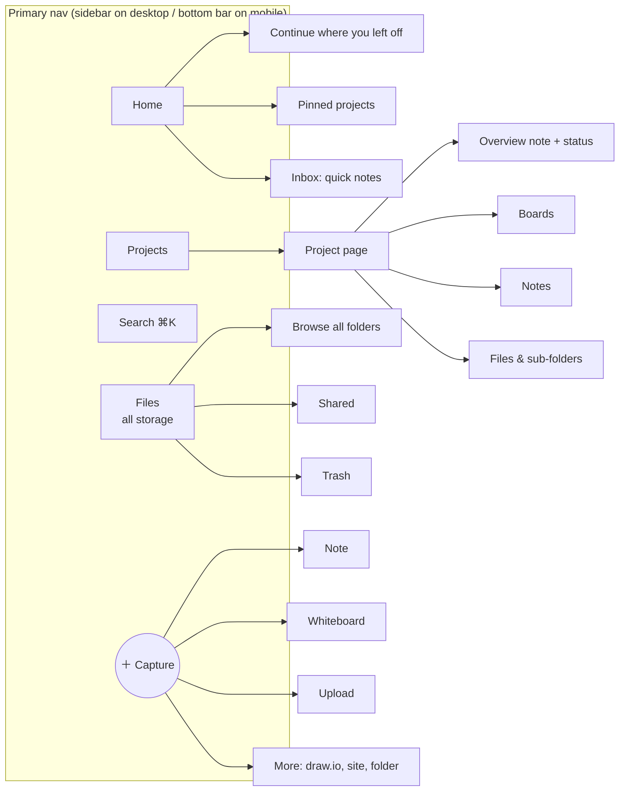
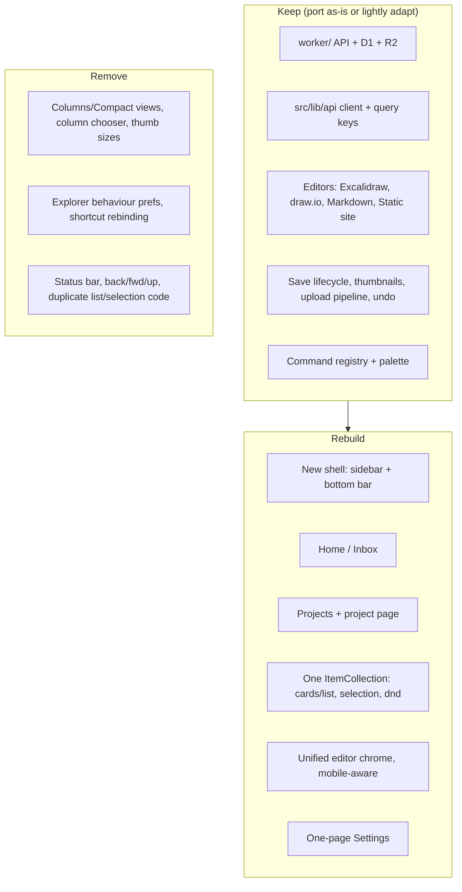

# Inkwell UX audit & redesign plan

_Audit date: 2026-11-03 · Screens captured with agent-browser at 1440×900 (desktop) and as an iPhone 14 (mobile). The screenshots are in [`./screenshots`](./screenshots)._

> **Decisions (2026-11-03)**
> - **Desktop first.** Mobile must work but is secondary.
> - **Project = every top-level folder.**
> - **Build strategy:** a new UI layer on top of the existing backend and editors (parallel routes, port, then delete the old UI).
> - **Remove from the UI:** Columns and Compact views, thumbnail sizes, column chooser, explorer behaviour settings, shortcut rebinding, tags in the sidebar. draw.io and static sites move under *More* in the New menu.
> - **Next priority after the shell and projects:** quick capture and great notes, **editor polish** (header, Ctrl+S, editor shortcuts), **import/export** (Excalidraw, draw.io, Markdown, standalone HTML artifacts).
> - **Visual direction:** **B · Warm & crafted** ([`mockups/b-warm.html`](./mockups/b-warm.html)). It is adopted for *look and feel only*: paper/ink palette, burnt-orange accent, serif headings (Fraunces) with a sans UI (Inter), soft cards. Mockup layouts and content are illustrative; UX is defined by this plan.
>   - **No emoji in the UI.** Use the existing **Hugeicons** stroke set everywhere. A project's identity is an icon from a curated set on a coloured tile (about 8 palette colours), chosen at creation and changeable later.
>   - **Show only real data.** Project cards show only data we actually have (status, item count, last edited, recent items). The progress bars and sparklines in the mockups are placeholders, not requirements.

---

## 1. What exists today (feature inventory)

| Area | What's there | Screens |
|---|---|---|
| **Shell** | Top bar (logo, global search ⌘K, uploads, shortcuts, account). Sidebar: New split-button, Upload, *Library* (Home, Recent, Starred, Shared links, Trash), *Folders* tree, *Tags*, Settings, Users. Status bar. Details panel. | 02, 09 |
| **Explorer** | 4 views (Grid / Compact / Details / Columns), remembered per folder. Filter box plus a filter popover (kind, tag). Sort menu. Thumbnail size (S–XL). Details-panel toggle. Back / Forward / Up buttons. Breadcrumb. Multi-select, rubber band, drag-drop, cut/copy/paste, undo. | 02–09 |
| **Item actions** | 16-entry context menu: open, new tab, quick look, share, copy link, star, tags, move, duplicate, download, cut, copy, rename, details, trash. | 10 |
| **Command palette / shortcuts** | Fuzzy search over files, folders, tags and commands. About 45 shortcuts, all of them rebindable. | 11, 12, 21-shortcuts |
| **Editors** | Excalidraw (full-screen). draw.io (embedded webapp with its own menu bar). Markdown in CodeMirror with Source / Split / Preview, Mermaid and KaTeX. Static site (bundle manager + "Open site"). Shared editor header: back, breadcrumb, save state, star, share, ⋯. | 13–18 |
| **Sharing** | Per-file or per-folder links with label, view/edit access, expiry chips and a downloads toggle. A *Shared links* table page with filters. | 19, 20-shares |
| **Library pages** | Recent, Starred, Tag pages, and Trash (30-day purge, restore, empty). | 20-* |
| **Settings** | Profile, Security, Appearance, **Explorer (≈13 knobs)**, **Shortcuts (rebinding)**, Editors (draw.io style, markdown width and typeface), Tags, About. | 20-settings, 21-* |
| **Admin** | Users table with filters, invites tab, invite popover. | 20-users |
| **Mobile (<768px)** | The sidebar becomes a drawer, there is a FAB (New file / New folder / Upload), a compact header and no status bar. | 30–32 |

**Backend:** Cloudflare Worker + D1 + R2. File kinds: `excalidraw | drawio | notes | static-site`. It has folders, tags, stars, soft-delete trash, shares, invites and optimistic concurrency. **The backend is solid and should be kept.**

---

## 2. Findings

### 2.1 What works well (keep)
- **The concept itself:** notes, whiteboards, diagrams and files in one place, self-hosted on Cloudflare.
- **Editors are high quality.** Excalidraw and markdown with live Mermaid render well (14, 17).
- **Command palette** with *Starred* and *Recent* sections (11). It is the fastest way to get around and deserves to be the main navigation, not something hidden.
- **Undo-first safety:** undo toasts, soft trash, 30-day purge.
- **Share dialog** has good defaults (View only, 7 days) and creates the link in one click (19).
- **Autosave with a visible state** ("Saved · v9").

### 2.2 Problems

**A. It's a file manager, not a workspace.**
The mental model is Finder/Explorer: the app opens on an empty grid of folders. Nothing reflects *projects*, *progress* or *what I was doing*. Projects are just folders. There is no overview, status, cover or "where I left off".

**B. Control overload.**
- The explorer toolbar has **12 controls** before any content: sidebar toggle, back, forward, up, breadcrumb, filter box, filter menu, sort, 4 view buttons, thumbnail size and details panel (02).
- **Four** view modes. Columns and Compact add little over Grid and List (07, 08).
- Explorer settings expose about 13 power-user knobs (single vs double click, same vs new tab, Alt-drag behaviour, upload conflicts, column chooser, details-panel mode…) (21-explorer).
- All shortcuts can be rebound (21-shortcuts), and seven font families ship.
- The context menu has 16 items (10).
- The status bar and the "? shortcuts · Ctrl K commands" footer are desktop-power-user chrome.

**C. Visual design.**
- Big cartoon folder illustrations dominate the grid. 11 folders fill the whole first screen on desktop and about 2.5 screens on mobile (02, 30-m-home). They carry no information: no preview, no progress, no recency.
- Files without thumbnails show a generic icon on a dark tile (02). The grid looks empty and uniform.
- The orange-on-brown palette in dark mode reads as heavy and low-contrast in places (selected nav, "Edited" chips).
- Hierarchy is weak: same-weight labels everywhere, with uppercase section headers (LIBRARY, FOLDERS, TAGS, FILES · 9).

**D. Navigation.**
- Three parallel ways to navigate folders: the sidebar tree, the breadcrumb plus Up button, and the Columns view. The sidebar tree lists every folder flat and gets long fast.
- "Home" mixes projects (folders) and loose files. There is no inbox for quick notes.
- Admin "Users" sits in the main sidebar for everyday use.

**E. Mobile is an afterthought.**
- The desktop layout is squeezed into a drawer. There is no bottom navigation, so the main destinations need two taps (31).
- The folder grid is huge: each folder card is about 40% of the screen height (30-m-home).
- **Markdown on mobile opens in source mode with line numbers**, and the title is truncated to "f…" (30-m-f-…). Reading or quick-editing a note on a phone is poor.
- **Excalidraw on mobile opens off-content** and shows "Scroll back to content" instead of fitting the drawing to the screen (30-m-f-skqkh…).
- The Shared links header overflows: "New link" is cut off and the columns are hidden (30-m-shares).
- Quick capture means FAB → "New file…" → choose kind → name → editor. That is too many steps for "jot something down".

**F. Missing for the stated workflow.**
- **Projects:** no overview, status/progress, pinning, cover or colour.
- **Quick capture:** no instant note and no inbox.
- **Knowledge-sharing sessions:** no presentation or "session" mode for whiteboards (Excalidraw full-screen, laser and frames to slides), and no link between a session's board and its notes.
- **Cloud storage:** only four editable kinds are accepted. PDFs, images, docs and archives cannot be stored or previewed.
- **Cross-linking:** notes can't easily embed or link to boards and other files.

**G. Minor and possible bugs (to verify)**
- An unmodified Excalidraw file showed an "Edited" badge right after opening (13).
- Trash shows "Purges in: soon" for items 38 days old. The cron doesn't run in local dev, but the label could be clearer.
- The sidebar shows many test folders (`WSD smoke…`, `ZZ Smoke…`) left by smoke tests that don't fully clean up.

---

## 3. Design principles for the rebuild

1. **Projects first, files second.** The app opens on *your work*, not a directory listing.
2. **Capture in one tap.** Any screen → new note in at most 2 interactions, with no naming required.
3. **One way to do each thing.** One list component, two layouts (Cards / List), one selection model, one search.
4. **Sensible defaults, no knobs.** Fixed behaviour where it doesn't matter (sort = recently edited, folders first, double-click to open on desktop and tap on touch, keep both on upload conflict). Settings fit on one screen.
5. **Desktop first, mobile-capable.** Design for a keyboard and a wide screen. Mobile gets a solid responsive fallback (bottom bar, sheets, reader-first notes), but it does not drive design decisions.
6. **Content is the UI.** Real previews (thumbnails, note excerpts, file icons) instead of decorative folder art.
7. **Power stays, but out of sight.** Shortcuts, ⌘K, multi-select and drag-drop all remain. They just don't occupy the screen.

---

## 4. Proposed information architecture



| Concept | Definition | Data-model impact |
|---|---|---|
| **Project** | A top-level folder promoted to a project, with emoji/colour, short description, status (Active / Paused / Done), pinned flag and an optional overview note. | Add `icon`, `color`, `description`, `status`, `pinned_at`, `is_project` (or "top-level = project") to `folders`. |
| **Inbox** | Where quick captures land when you're not inside a project. Items can be filed into a project later. | Reuse the root (`folder_id = null`) as the Inbox, or add a system folder. |
| **Item** | Any note, board, diagram, site or **generic file** (PDF, image…). | Add `kind = 'file'` with a stored MIME type, plus server-side preview for images and PDFs. |
| **Session** _(later)_ | A whiteboard plus linked notes, with a "Present" mode. | Optional `links` table (item ↔ item). |

**Removed or demoted:** Tags (kept in the data model but removed from primary nav; available as a filter chip in search), the Columns and Compact views, the status bar, back/forward/up buttons, thumbnail size, column chooser, explorer behaviour settings, shortcut rebinding and extra fonts. *Users* moves to Settings → Admin.

---

## 5. Key screens (wireframe intent)

### Desktop
```
┌──────────────┬─────────────────────────────────────────────────────┐
│ ◉ inkwell    │  Good morning, Thilina           [ ⌘K Search… ] [＋]│
│              │                                                     │
│ ⌂ Home       │  Continue                                           │
│ ▣ Projects   │  [board thumb] [note excerpt] [diagram] [note]  →   │
│ ⇪ Files      │                                                     │
│              │  Pinned projects                                    │
│ PROJECTS     │  ┌────────┐ ┌────────┐ ┌────────┐                   │
│ ● Atlas      │  │🚀 Atlas│ │📚 Talks│ │🧪 Lab  │  status · 12 items│
│ ● Talks      │  └────────┘ └────────┘ └────────┘  edited 2h ago    │
│ ● Lab        │                                                     │
│ + New project│  Inbox (3)                     [ Quick note… ⏎ ]    │
│              │  • idea about caching          · 10m                │
│ ⚙ Settings   │                                                     │
└──────────────┴─────────────────────────────────────────────────────┘
```

**Project page:** header (emoji, name, status pill, ⋯), the overview note inline (collapsible), then a single item grid with type chips `All · Boards · Notes · Files` and a `Cards | List` toggle. That is the whole toolbar.

### Mobile
```
┌───────────────────────┐
│ Atlas ▾          ⋯    │  ← project switcher sheet
│ [All][Boards][Notes]… │
│ ┌─────┐ ┌─────┐       │  2-col cards with real previews
│ │thumb│ │ note│       │
│ └─────┘ └─────┘       │
│                       │
├───────────────────────┤
│ ⌂    ▣    ＋    🔍   ⇪ │  ← bottom bar; ＋ = capture sheet
└───────────────────────┘
```
- **＋ Capture sheet:** big "Note" (opens a ready-to-type note immediately, auto-titled from its first line), "Whiteboard", "Upload / Photo", "More…". The default target is the current project, otherwise the Inbox.
- **Notes on mobile:** reader view by default, tap to edit in a WYSIWYG-ish live-preview mode (CodeMirror live markdown without line numbers), with a keyboard toolbar.
- **Boards on mobile:** fit-to-content on open. View-first, with edit available.
- **Item actions:** a long-press bottom sheet with about 6 actions (Share, Move, Star, Rename, Download, Delete). Advanced actions sit behind "More".

---

## 6. Build strategy: "fresh UI layer, same backend"

Rewriting everything is unnecessary. The Worker, D1 schema, R2 layout, API client, editors and save lifecycle are good. The **presentation layer** (shell, explorer, library pages, settings) is where the complexity lives: `ExplorerToolbar` has 582 lines, there are two selection models, two list renderers and four view components.



Recommended mechanics: build the new shell under a feature flag or a parallel route tree (`/app/*`) so the old UI keeps working while pages are ported. Switch the default route when parity is reached, then delete the old code.

---

## 7. Phased roadmap

| Phase | Scope | Outcome |
|---|---|---|
| **0. Foundations** (≈1 wk) | Design tokens (type scale, 1–2 fonts, refined light and dark palettes, spacing, radius). New responsive shell (desktop sidebar, mobile bottom bar plus sheets). One `ItemCollection` component (Cards / List, single selection model, drag-drop, long-press). Routing skeleton. | A new look you can navigate |
| **1. Projects & Home** (≈1–2 wk) | Folder metadata migration (icon, colour, status, pinned, description). Home (Continue, Pinned projects, Inbox). Projects list and project page with overview note. Slim sidebar project list. | A projects-first workflow |
| **2. Capture & editors** (≈2 wk) | Capture box and `N` shortcut. Instant untitled note with first-line titling. **Unified slim editor header** for every kind. **Ctrl/⌘+S** = save now (autosave stays on). Consistent editor shortcuts (Ctrl+S, Ctrl+Shift+S export, Ctrl+K palette, Esc back). Excalidraw fit-to-content. Fix the "Edited" state bug. Basic mobile reader for notes. | Editors feel first-class |
| **2b. Import / export** (≈1 wk) | Drag-in import anywhere (`.excalidraw`, `.drawio`/`.xml`, `.md`, `.html`, `.zip`). An *Export as…* menu per kind (Excalidraw → .excalidraw/PNG/SVG; draw.io → .drawio/PNG/SVG; Markdown → .md/HTML/PDF; site → .zip). **Single-file HTML artifacts** as a first-class viewer (sandboxed preview + source) instead of the bundle manager. | Easy to move work in and out |
| **3. Search, share, trash, settings** (≈1 wk) | ⌘K as the primary search with type and project chips (tags folded in). Simplified Shared and Trash pages (mobile-safe). One-page Settings (Profile, Appearance, Security; Admin: Users & invites). | Feature parity with the old UI; the old UI is removed |
| **4. Cloud storage** (≈2 wk) | Generic `file` kind (any MIME), upload anywhere (incl. camera on mobile), previews for images, PDF, video, audio and text. Storage usage meter. | Notes + storage in one app |
| **5. Sessions & beyond** (later) | Whiteboard **Present mode** (frames as slides, laser, follow). "New session" template (board + notes pair). Item links and embeds (embed a board in a note). PWA/offline. Templates. | Built for knowledge-sharing sessions |

---

## 8. Settings: before → after

| Today (≈30 controls across 8 sections) | Proposed |
|---|---|
| Default view, thumbnail size, sort, folders first, details-panel mode, list columns | Fixed: Cards on desktop and mobile, recently-edited first, folders first. The Cards/List toggle is remembered per device. |
| Open with single/double click, same/new tab, Alt-drag, upload conflict, confirm trash, single-key shortcuts | Fixed defaults: double-click (desktop) or tap (touch), same tab (⌘-click for a new one), keep both on conflict, undo instead of confirm |
| Shortcut rebinding | Removed (the shortcut sheet stays) |
| draw.io style, markdown width, 6 typefaces | Theme (Light/Dark/System) and *one* "Note font: Sans/Serif" toggle |
| Profile, Security, Tags, About, Users (separate page) | Profile and password · Appearance · Admin (users, invites) · About, all on **one page** |
